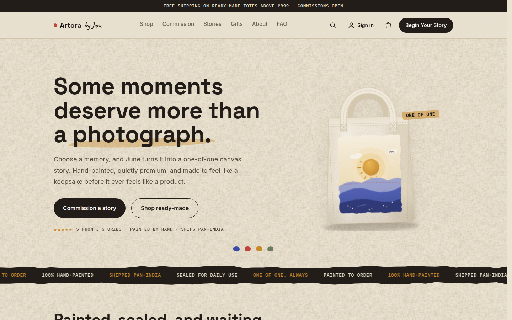
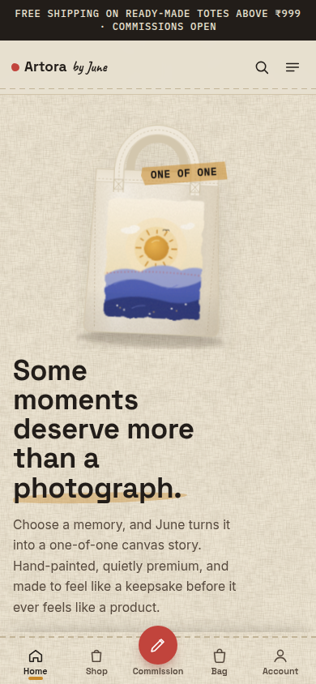
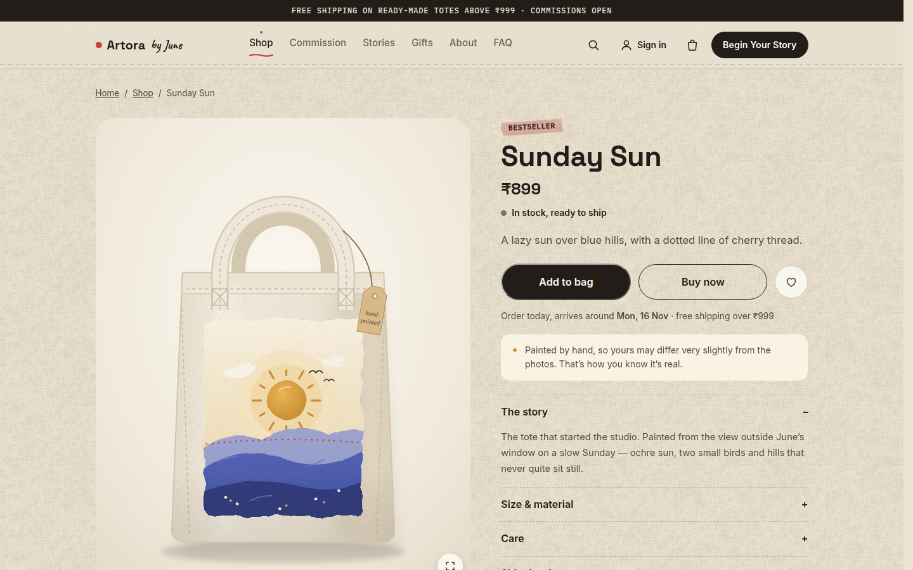
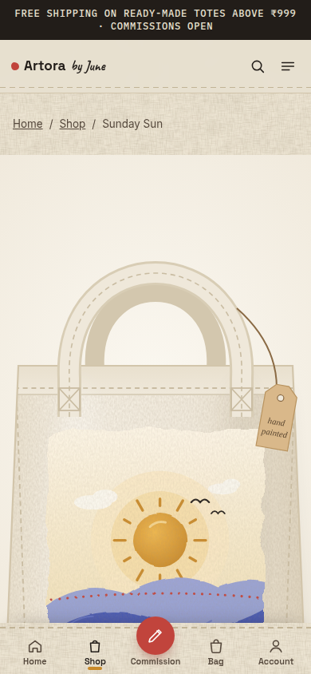
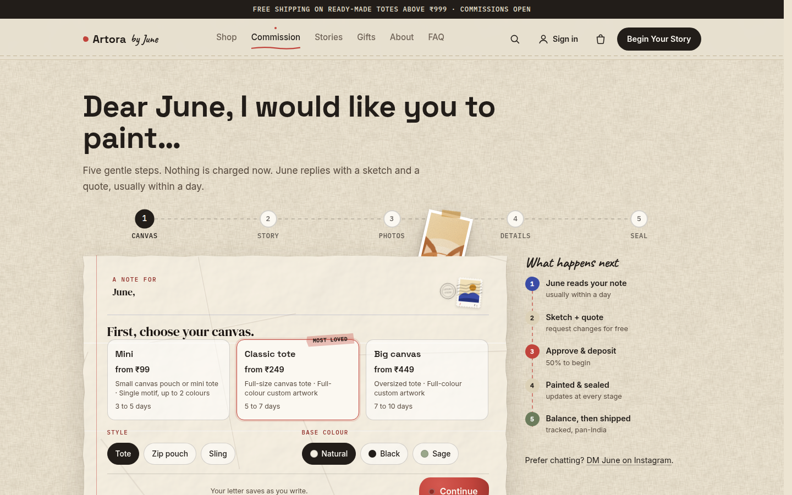
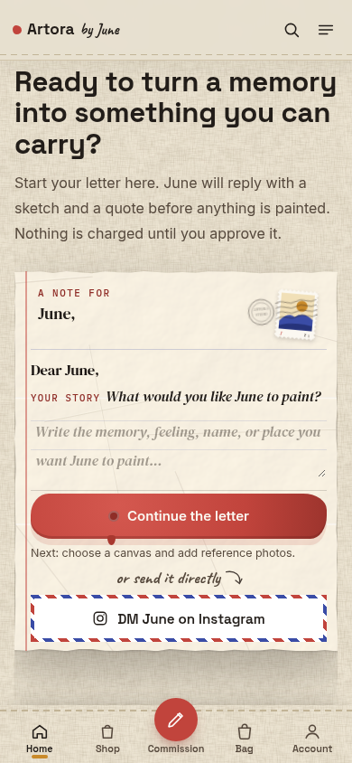

# Artora by June — custom tote studio (client project)

A full storefront and commission studio I designed and built for **Artora by June**, a small studio that hand-paints custom tote bags.

**Live site:** [artorabyjune.vercel.app](https://artorabyjune.vercel.app)

> Built for a client. The live site, its data and its accounts are owned by the client; this repository is a portfolio copy, shown with permission. It contains no customer data, passwords or keys.

| Desktop | Phone |
| --- | --- |
|  |  |
|  |  |
|  |  |

More: [shop](docs/screenshots/shop-desktop.png) · [gifting guide](docs/screenshots/gifts-desktop.png)

## What I built

- **A hand-made design system.** No generic cards or boxes: price tags on a clothesline, crumpled letter paper, kraft parcel tags, polaroids, stitched seams, painted colour dabs. All CSS and SVG, no image-heavy templates.
- **Commission flow.** Customers write a "Dear June" letter, get a sketch and quote, pay a 50% deposit, follow each painting stage and pay the balance before shipping.
- **Shop and checkout.** Cart, coupons, bundles, gift cards, gift wrap, free-shipping threshold, notify-me for sold-out totes.
- **Admin studio.** Orders, quotes, stages and tracking, products with photo upload, reviews, coupons and every line of site copy, without touching code.
- **Security.** Prices are computed on the server, payments verified by signature, Helmet CSP, rate limits, same-origin checks, httpOnly cookies.
- **Serverless deployment.** Runs on Vercel next to MongoDB Atlas in Mumbai, with a reused database connection, a daily cron for cart reminders, and pages at about 0.2 s.
- **Phone-first touches.** Thumb-reach tab bar, auto-sliding swipe rows, sticky buy bar, bottom sheets.

## Tech

Node 20 · Express 5 · MongoDB (Mongoose) · plain HTML/CSS/ES modules (no build step) · Vercel · Cloudinary · Resend · Razorpay · zod · node:test + supertest

---

## Technical overview

Storefront, custom-commission studio and admin for **Artora by June**, a studio selling hand-painted totes.

- **Shop:** ready-made totes with a cart, coupons, gift wrap, free-shipping threshold, and notify-me for sold-out items.
- **Commissions:** a 5-step "Dear June" letter. June sends a quote and sketch, the customer approves and pays a 50% deposit, then pays the balance before shipping.
- **Payments:** Razorpay (UPI, cards, netbanking). Without Razorpay keys, checkout falls back to manual UPI and June marks orders paid in the admin.
- **Admin** at `/admin`: dashboard, orders and commissions, products, coupons, reviews, site copy, messages, subscribers, admin access.
- **Shop extras:** search, saved totes (synced to the account), recently viewed, a photo lightbox, bundles, gift cards and store credit, and one abandoned-cart reminder (`server/services/reminders.js`).
- **Emails** through Resend, **photo storage** through Cloudinary, optional Google sign-in and Plausible analytics.

The owner's guide (deploying, connecting services, daily use) is **[HANDOVER.md](HANDOVER.md)**.

## Stack

Plain HTML/CSS/ES modules with no build step, served by Node 20+ / Express 5 with MongoDB (Mongoose). Validation uses zod; security uses Helmet CSP, rate limits, same-origin checks, and httpOnly JWT cookies.

```
server/
  index.js          boot (validates env, connects Mongo, seeds default site copy)
  app.js            Express app: security headers, static /public, API, pages
  config.js         all env vars in one place; refuses weak secrets in production
  routes/           auth, me, public, orders (checkout/commissions/payments), admin, uploads, pages
  lib/              pricing (server-side only), orders, stages/timeline, content defaults, page render
  models/           User, Product, Order, Coupon, GiftCard, CartDraft, Review, Content, Message, Subscriber, Counter
  services/         razorpay, email (templates), cloudinary, reminders (abandoned-cart email)
  scripts/          seed.js, create-admin.js
views/              HTML pages + partials (header, footer, head), rendered with SEO meta
public/             the only folder served statically: css/, js/core, js/pages, assets/
tests/              node:test + supertest + in-memory MongoDB
tools/illustrations build.js: every SVG (artworks, tote mockups, animated spots, June, 404, favicon, textures, hero tote)
                    render-png.js: share images, email art, WebP texture (needs local Chrome)
```

### Look and illustrations
- `public/css/canvas.css` is the theme layer, loaded last: canvas weave, stitched seams, crumpled-paper letters, hang tags, receipts, labels and motion. It changes surfaces only, never behaviour.
- All artwork is generated. Edit `tools/illustrations/build.js`, then run `npm run illustrations` (SVGs, plus the hero tote injected between the `hero-tote` markers in `views/index.html`). Run `npm run illustrations:png` after changing anything that appears in a share image or email.
- Design rule from the client: no generic boxed tiles or label pills. Containers become studio objects (tags, labels, letters, polaroids, seams). A plain box is OK only when it holds a form.

`legacy-index.html` and `legacy-artorabyjune.js` are the original single-page version, kept for reference only. They are never served and can be deleted.

## Local development

```bash
npm install
cp .env.example .env          # set MONGODB_URI (local Mongo or Atlas) and JWT_SECRET
npm run seed                  # sample products, reviews and coupons
npm run create-admin -- you@example.com "a-strong-password" "June"
npm run dev                   # http://localhost:3000, restarts on change
npm test                      # API tests (downloads a MongoDB binary on first run)
```

Without Razorpay, Resend or Cloudinary keys the site still works locally. Emails are logged to the console, payments use manual UPI, and uploads go to `./uploads`.

## Deploying

- **Render (recommended):** `render.yaml` is a Blueprint. See HANDOVER.md, step 2.
- **Docker / any VPS:** `docker build -t artora . && docker run -p 3000:3000 --env-file .env artora`. Put it behind HTTPS (Caddy, nginx or Cloudflare). For uploads on the server's disk instead of Cloudinary, set `ALLOW_LOCAL_UPLOADS=1` and mount `/app/uploads` as a volume.

Health check: `GET /api/health`.

## Notes for developers

- Prices are always computed on the server (`server/lib/pricing.js`). Client cart prices are display-only.
- Order numbers (`AJ-0001`) come from an atomic counter, so they stay unique under concurrent orders.
- Stock is checked at checkout and reduced when payment lands. If two people pay for the last item, the second order is flagged `OVERSOLD` in its internal notes and the admin gets an email.
- The Razorpay webhook (`/api/payments/webhook`) is a backup for the browser callback. Payments are recorded exactly once.
- Admin can only edit whitelisted content keys (`EDITABLE_KEYS` in `server/lib/content.js`).
